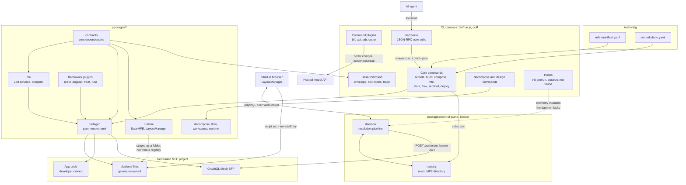
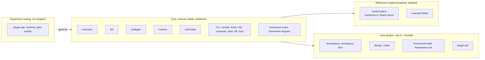

# B. Architecture Assessment

## 1. Purpose and users

**Stated purpose (fact, `README.md`, `CLAUDE.md`):** deliver domain features as independently deployable units in any framework. A manifest declares capabilities. A generator turns it into code. A runtime gives every MFE the same lifecycle so a shell can compose them.

**Users, as the code serves them:**

| User | Served by | Evidence |
|---|---|---|
| MFE author | `remote:init`, `remote:generate`, `build:*`, `mfe:validate` | `src/commands/remote/`, `src/commands/build/` |
| Shell or fleet operator | `compose:build`, `compose:validate`, `slots:validate`, the control plane | `src/commands/compose/`, `packages/control-plane/` |
| AI agent | `--json` envelope, `mcp:serve`, generated schemas | `packages/oclif-base/`, `src/mcp/`, `schemas/` |
| Team splitting a monolith | nine `decompose:*` commands, the workspace | `src/commands/decompose/`, `packages/workspace/` |
| Platform maintainer | `adr:*`, 20+ `check:*` and `build:*:check` scripts | `packages/plugin-adr/`, `scripts/` |

**Inference:** there is one maintainer. Every ADR sampled lists `deciders: [sean]`.

## 2. Current-state architecture

Dashed lines mark paths that exist in code but do not work as described. See ARC-01 and ARC-05.

## 3. Component inventory

### Executables and entry points

| Entry | Role | Note |
|---|---|---|
| `bin/run.js` | Published Node entry | Falls back to `ts-node` when `dist/` is missing. `ts-node` is a devDependency (QC-06) |
| `bin/dev.ts` | Bun dev entry | |
| `packages/control-plane/daemon/simple-daemon.js` | Daemon service, CommonJS | Port 3004 by default |
| `packages/control-plane/registry/simple-registry.js` | Registry service, ESM | Port 4000 by default |
| Generated `server.ts` | Per-MFE BFF and static host | From `packages/plugin-bff/templates/server.ts.ejs` |
| `decompose:workspace` | Local API, BFF and front door on 127.0.0.1 | `packages/workspace/src/run/workspace.ts` |

### Packages

Sizes are non-test TypeScript lines, measured with `wc -l`.

| Package | Lines | Role | Published |
|---|---|---|---|
| `contracts` | 2,456 | Capabilities, lifecycle, errors, envelope, slot grammar | No |
| `dsl` | 3,025 | Manifest schema, parser, composition compiler | No |
| `codegen` | 3,413 | Manifest to files, ownership, migrations | No |
| `runtime` | 4,898 | `BaseMFE`, layout manager, control-plane client | No, `private: true` |
| `oclif-base` | 467 | `BaseCommand`, logger, JSON output | No |
| `framework-react`, `-angular` | 347, 334 | Web target plugins | No |
| `framework-swift`, `-rust` | 624, 656 | Native target plugins | No |
| `plugin-bff` | 1,106 | `bff:*` commands | No |
| `plugin-api` | 815 TS + 2,296 legacy JS | OpenAPI to Express API | No |
| `plugin-adr` | 1,293 | ADR governance | No |
| `plugin-coder` | 822 | Model transport, prompt adaptors | No |
| `decompose` | 2,039 | Proposal model | No |
| `flow` | 313 | Flow status engine | No |
| `workspace` | 2,371 | Workspace API and runner | No |
| `sentinel` | 224 | Governance kernel, unscoped name | No |
| `control-plane` | 1,375 JS | Registry and daemon | Docker only |

### Command surface

Thirty-one commands have schemas in `schemas/`. Two more (`mcp:serve`, `schemas`) do not.

| Topic | Commands | Stability (reviewer's reading) |
|---|---|---|
| `remote` | `init`, `generate`, `generate:capability` | Core |
| `build` | `dev`, `prod`, `docker`, `check` | Core |
| `mfe`, `slots`, `compose` | `validate`, `validate`, `build`, `validate` | Core |
| `bff` | `init`, `build`, `dev`, `validate` | Core |
| `mcp`, `schemas` | `serve`, `schemas` | Core |
| `deploy` | `deploy` | Broken, see ARC-04 |
| `api` | `api` | Legacy |
| `adr` | `status`, `validate` | Repository tooling |
| `sentinel`, `flow` | `validate`, `status` | Early |
| `decompose` | 9 commands | Early, a second product |
| `design`, `coder` | `export`, `compile` | Proof of concept |

### Extension interfaces

| Interface | Mechanism | Contract doc |
|---|---|---|
| Command plugin | oclif plugin, extends `BaseCommand` | `docs/PLUGIN-CONTRACT.md` |
| Framework or target plugin | `loadFrameworkPlugin()`, `loadTargetPlugins()`, `registerCodegen()` | `docs/framework-plugin-authoring.md` |
| Lifecycle hooks | Manifest `lifecycle.before/after/error`, handler files | ADR-002, ADR-040 |
| MCP tool sources | Local schemas, plugin schemas, remote servers | README, partly non-functional (ARC-03) |
| Flows | `flows/*.yaml` | `docs/flows.md` |
| Sentinel ports | Four ports, host adapters | ADR-089 |

### State and persistence

| State | Where | Durability |
|---|---|---|
| Manifests, composition, proposals | Files in the project, in git | Durable |
| Generated schemas, `rules.json`, doc indexes | Committed, regenerated and diffed in CI | Durable |
| Registry rules and MFE directory | Memory in the registry process | Lost on restart |
| Daemon component state and sessions | Memory in the daemon process | Lost on restart |
| CLI offline-daemon marker | `~/.cache/seans-mfe/daemon-offline` | 60 seconds |
| User MCP federation config | `~/.config/seans-mfe/mcp.json` | Durable |

### External integrations

Docker CLI, npm, GraphQL Mesh, Playwright and Chromium, git, the Anthropic Messages API, an external `coder` binary, Swift and Cargo toolchains, GitHub Actions and Pages.

## 4. What is designed and what accumulated

| Deliberately designed | Accumulated |
|---|---|
| `contracts` with zero dependencies, layering enforced by `src/__tests__/import-direction.test.ts` | `packages/plugin-api`: 2,296 lines of untyped JavaScript generators |
| `BaseCommand` envelope and exit-code contract | `src/commands/deploy.ts`: targets a project layout the generator no longer emits |
| File ownership through the `overwrite` flag, with a migration registry (ADR-082) | Control plane named `simple-*.js`, one CommonJS and one ESM |
| Drift gates on every generated artifact | `.husky/pre-commit` pointing at a directory that no longer exists |
| Framework plugins carrying build and codegen halves | `package.json` description and keywords from the original React and MUI scaffolder |
| MCP child process per call (ADR-019) | MCP plugin and remote sources that list but cannot invoke |

## 5. Where implementation diverges from stated intent

| Stated | Implemented | Finding |
|---|---|---|
| "The runtime ships as `@seans-mfe-tool/runtime`" (README) | Not published. Templates declare `^0.1.0`; examples use `file:../../../dist/runtime` | ARC-01 |
| MCP "proxies external MCP servers" (README) | `tools/call` always spawns the local CLI. Remote tools resolve to a command that does not exist | ARC-03 |
| "All mutating commands accept `--dry-run`" (README, getting-started) | Nine command files declare it. `build:docker`, `decompose:capture`, `decompose:propose`, `design:export` and others write files without it | QC-05 |
| "No `console.log` in production code" (CLAUDE.md) | About 385 console calls in command code. `no-console` is off except in three packages | QC-01 |
| The control plane is the canonical platform implementation (PDR-008) | Demo-grade services with no authentication and no tests in their directory | ARC-02, SEC-02 |
| `postrun` emits telemetry to the daemon (PROJECT-STATUS) | Sends `mutation { telemetry }`. The daemon schema has one mutation, `sendMessage` | ARC-05 |
| "Node ≥18" (CLAUDE.md, getting-started) | `engines.node` is `>=20`, `.nvmrc` is 22, CI runs 20 and 22 | QC-01 |

## 6. Architectural quality

### Separation of concerns

**Good.** Libraries do not print. `contracts`, `dsl` and `codegen` have `no-console` as an error and report through diagnostics. Commands are mostly thin wrappers: `sentinel/validate.ts` is 65 lines, `flow/status.ts` is 93.

**Weak spots.**
- `packages/plugin-api/src/commands/api.ts` is 785 lines and holds generation logic in the command file.
- `src/commands/deploy.ts` is 371 lines of Docker orchestration with module-level signal handlers.
- `src/commands/remote/generate.ts` is 398 lines.
- `src/decompose/` (capture, analysis, clustering, verify) lives in the CLI tree while its model lives in `packages/decompose`. ADR-118 explains the split, but a reader meets two homes for one feature.

### Consistency

**Consistent:** error types, exit codes, the envelope, the plugin loader, generate-and-diff gates.

**Inconsistent:** flag names, project addressing, logging in commands, module systems in the control plane, package namespaces (`@seans-mfe/*`, `@seans-mfe-tool/runtime`, unscoped `sentinel`, `@falese/*`).

### Extensibility

| Task | Effort today | Blocker |
|---|---|---|
| Add a CLI command | Low. Extend `BaseCommand`, add a result type, run `npm run build` | None inside the repo |
| Add an external command plugin | Cannot be done cleanly. `@seans-mfe/oclif-base` and `@seans-mfe/contracts` are not published, so a third party has nothing to depend on | ARC-01 |
| Add a framework | Moderate. Good guide. Same publishing blocker for third parties | ARC-01 |
| Add a runtime capability | High by design. The ten capabilities are a closed set (ADR-041, ADR-080) | Intentional |
| Add an MCP tool from another server | Does not work | ARC-03 |

### Maintainability

- **Dependency direction** is one-way and tested. No cycles were found by reading the package manifests. Not verified with a tool.
- **Gate count is itself a cost.** `CLAUDE.md` lists sixteen pre-push steps, several with a stale-build trap. Each gate is justified by an incident. Together they are a heavy ritual for a contributor.
- **ADR velocity.** 120 ADRs, 83 implemented. The record is a strength. It is also a reading burden, and 10 are still proposed.

## 7. Target architecture

Evolve in place. No rewrite is justified.

The changes this implies:

1. **Publish the core.** Runtime first (ADR-064), then contracts, dsl, codegen, oclif-base and the CLI. Replace `file:` links with versions at pack time.
2. **Move `decompose:*`, `design:*`, `flow:*` out of the core command tree into plugins.** `plugin-coder` already shows the pattern. This shrinks the default help output from 33 commands to about 16.
3. **Give the control plane one identity.** Rename away from `simple-*`, one module system, typed, tested, authenticated. Or label it a reference and stop calling it canonical.
4. **Make MCP exposure declarative.** Each command declares whether it is agent-callable, read-only or destructive. The registry reads that instead of exposing every schema.
5. **Retire `deploy`** until ADR-062's deploy-target plugins exist.
6. **Keep** the envelope, the error taxonomy, the ownership model, the drift gates and the layering exactly as they are.

**Compatibility note.** Renaming `@seans-mfe-tool/runtime` is a breaking change for every generated MFE (tracked in #362). Publish under the current name first. Rename later through the migration registry, if at all.
