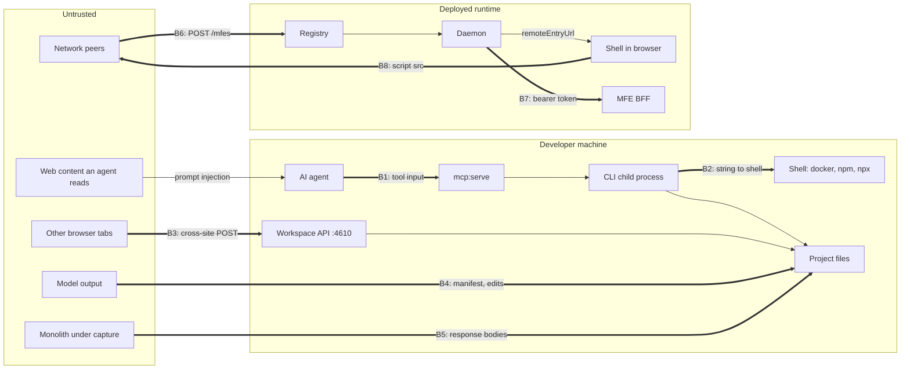

# D. Security and Safety Assessment

All findings here were established by reading code. Nothing was exploited, and no secret values appear in this document. Finding ids refer to the [register](./C-findings-register.md).

## 1. System under assessment

There are four separate attack surfaces. They have different owners and different exposure.

| Surface | Runs where | Who can reach it |
|---|---|---|
| The CLI | Developer machine, CI | The developer, scripts, and AI agents through MCP |
| The control plane | Containers, ports published | Anything on the network it is bound to |
| Generated MFEs and BFFs | Browsers and containers | End users |
| The local workspace | Developer machine, loopback | Any process or browser tab on that machine |

## 2. Trust boundaries

Thick arrows are boundaries where untrusted data crosses into a more privileged context.

| Boundary | Control present today | Finding |
|---|---|---|
| B1 agent to MCP | None. No schema validation, no allow-list | SEC-06 |
| B2 CLI to shell | None in `deploy` and `build:docker`. Argument arrays elsewhere in several places | SEC-01 |
| B3 browser to workspace | Loopback bind only | SEC-07 |
| B4 model to files | Strong for decomposition edits: Zod schema plus oracle check. Weak for manifest names and paths | SEC-08 |
| B5 captured app to files | None. Bodies stored as received | SEC-10 |
| B6 network to registry | None | SEC-02 |
| B7 daemon to MFE | None. Token sent to whatever URL was registered | SEC-02 |
| B8 shell to remote script | None. No origin allow-list, no integrity check | SEC-02 |

## 3. Assets

| Asset | Where it lives | Exposed by |
|---|---|---|
| Developer's shell and files | Developer machine | SEC-01, SEC-06, SEC-08 |
| End-user JWTs | Daemon sessions, BFF requests, telemetry | SEC-02, SEC-04 |
| End-user session in the shell origin | Browser | SEC-02 |
| `JWT_SECRET` | BFF and API environment | Not found leaked. Generated API fails fast when it is missing in production, which is good |
| `ANTHROPIC_API_KEY` | CLI environment | Inherited by every MCP child process (SEC-06) |
| Captured application data | Evidence bundles on disk, possibly in git | SEC-10 |
| Integrity of an approval | `decomposition.yaml` | SEC-07 |

## 4. Abuse scenarios

### S1. Prompt injection to host command execution

1. A developer runs `mcp:serve` for an agent.
2. The agent reads a README or issue containing instructions.
3. It calls the `mfe:deploy` tool with a crafted `name`.
4. `deploy.ts` passes the name into a shell string.

**Findings:** SEC-01, SEC-06. **Severity:** P0. **Likelihood:** realistic. Agents are a stated primary consumer of this CLI.

### S2. Rogue MFE registration

1. An attacker on the same network posts a registration to the registry with their own `baseUrl` and `remoteEntryUrl`.
2. A rule routes some context to that MFE.
3. The daemon posts the user's bearer token to the attacker's `/authorize`.
4. The shell loads the attacker's script into its own origin.

**Findings:** SEC-02, SEC-03. **Severity:** P0 once the control plane is reachable beyond one machine.

### S3. Cross-site WebSocket use of the daemon

A page on any origin opens a WebSocket to the daemon on localhost and subscribes to `messages` or sends actions. No `Origin` check exists.

**Finding:** SEC-02. **Severity:** P1.

### S4. Forged approval

A page the developer visits posts `{"edits":[{"kind":"approve"}]}` to the workspace API as a simple request. The handler parses the body whatever its content type and attributes the edit to the developer.

**Finding:** SEC-07. **Severity:** P2. Impact is integrity of a governance record, plus paid model calls through `/api/ask`.

### S5. Token harvesting from logs

Any failed validation emits the token. An attacker who can read telemetry replays tokens that failed only because of clock skew or a role check.

**Finding:** SEC-04. **Severity:** P1.

### S6. Identity spoofing in a generated BFF

A caller sends an unsigned token with a chosen `sub`. `context.userId` reflects it. A resolver that filters by `userId` returns another user's data.

**Finding:** SEC-05. **Severity:** P1. Depends on how adopters use the field, which is unknown.

### S7. Path escape through a machine-written manifest

A model, or a poisoned monolith during decomposition, yields a capability name containing path segments. The generator writes outside the project.

**Finding:** SEC-08. **Severity:** P2. Inferred, not executed.

## 5. Assessment by category

### CLI and execution safety

| Check | Status | Evidence |
|---|---|---|
| Command injection | **Vulnerable** | SEC-01 |
| Subprocess hygiene elsewhere | Mixed. `execFile` with arrays in `plugin-coder`, `workspace`, and gate scripts. `shell: true` in `framework-react/src/plugin.ts:95`, `framework-angular/src/plugin.ts:103`, `plugin-bff/.../dev.ts:25`, with fixed command strings and a numeric port | Low risk as written |
| Path traversal on read | Good where checked. The screenshot route confines to `screens/` (`workspace/src/api/server.ts:160-168`) | |
| Path traversal on write | **Unconfined** | SEC-08 |
| Destructive actions without confirmation | `deploy` stops and removes an existing container of the same name without asking. `--force` on generate is explicit. Developer-owned files are never overwritten, which is a strong safety property | |
| Interactive blocking | Good. `--no-interactive` and `--json` block prompts | `BaseCommand.ts` |

### Runtime security

| Check | Status |
|---|---|
| Authentication on control-plane APIs | **Absent** (SEC-02) |
| Authorization default | **Fail-open** (SEC-03) |
| JWT verification | Algorithm pinned to HS256, secret required. Good. Shared secret only (SEC-11) |
| Isolation between MFEs | None beyond the browser's. Module Federation shares the origin. This is inherent to the delivery mechanism and should be documented as a trust statement |
| Input validation at the daemon | `sendMessage` parses JSON and passes it on. Depth and size limits were not found |
| Resource limits | No rate limiting or body limits found on the registry, daemon or workspace API |
| Generated BFF hardening | `helmet`, non-root `USER`, `HEALTHCHECK` present. CORS defaults to `*` (SEC-05) |

### Supply chain

See SEC-09. In short: lockfile present and `npm ci` used in CI, which is good. No scanning, no update automation, mutable Action tags, no provenance.

Two by-design code-execution paths deserve a documented trust statement:
- `plugins install <pkg>` runs arbitrary npm code. That is how oclif plugins work.
- `~/.config/seans-mfe/mcp.json` entries are spawned at `mcp:serve` startup (`sources/remote.ts:125`).

### Operational safety

| Check | Status |
|---|---|
| Secrets in logs | **Token in telemetry** (SEC-04). MCP returns child stderr to the model verbatim, which can carry environment detail |
| Debug modes | `DEBUG` prints stack traces only. Acceptable |
| Auditability | The envelope carries a correlation id and trace id. Workspace edits carry `by` and `at`. The control plane has no audit trail of registrations |
| Recovery from failed operations | Generation is idempotent and regenerable. `deploy` cleans its temp directory on signals |

## 6. Mitigation plan

| Order | Action | Findings | Effort |
|---|---|---|---|
| 1 | Argument arrays and name validation in `deploy`, `build:docker` | SEC-01 | S |
| 2 | Remove token and claims from telemetry | SEC-04 | S |
| 3 | MCP: schema validation, exposure metadata, `cwd` root, env allow-list, process-group kill | SEC-06 | M |
| 4 | Workspace API: session token, `Origin` check, body cap | SEC-07 | S |
| 5 | Schema grammar for names; path confinement before write | SEC-08 | S |
| 6 | BFF template: verify or rename `userId`; require `CORS_ORIGIN` in production | SEC-05 | S |
| 7 | Dependabot, `npm audit` in CI, SHA-pinned Actions, `npm ci` in Dockerfiles, non-root control-plane images | SEC-09 | M |
| 8 | Control plane: registration auth, default-deny, origin allow-list in the shell, WebSocket `Origin` check, loopback default | SEC-02, SEC-03 | L |
| 9 | Capture redaction and a data-handling statement | SEC-10 | M |
| 10 | `SECURITY.md`, `CODEOWNERS` | SEC-12 | S |

Items 1 to 7 and 10 fit the first milestone. Item 8 needs a decision first (see [B §7](./B-architecture-assessment.md#7-target-architecture)) and probably an ADR.

## 7. Unresolved questions

1. **Is the control plane meant to run in production?** PDR-008 says it is canonical. Its file names and README say demo. The answer sets SEC-02's severity.
2. **Where does telemetry go?** If `context.emit` reaches a third party, SEC-04 is a reportable exposure for any real deployment.
3. **What does `decompose:ask` send to the hosted model?** Not traced in this review.
4. **Are evidence bundles meant to be committed?** The proposal flow suggests yes.
5. **Has any dependency a known vulnerability today?** Not evaluated.
6. **Is this repository public?** A Pages site suggests so. If it is, the example `.env.example` files and compose defaults should be reviewed once for anything that looks like a real credential. A filename search found only `.env.example` files, and their contents were not read.
